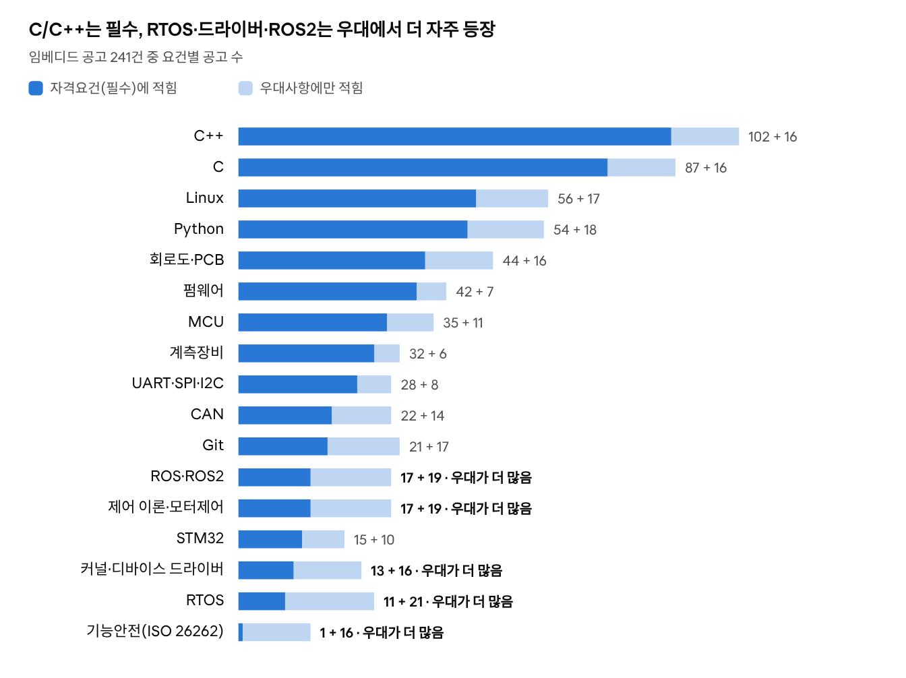
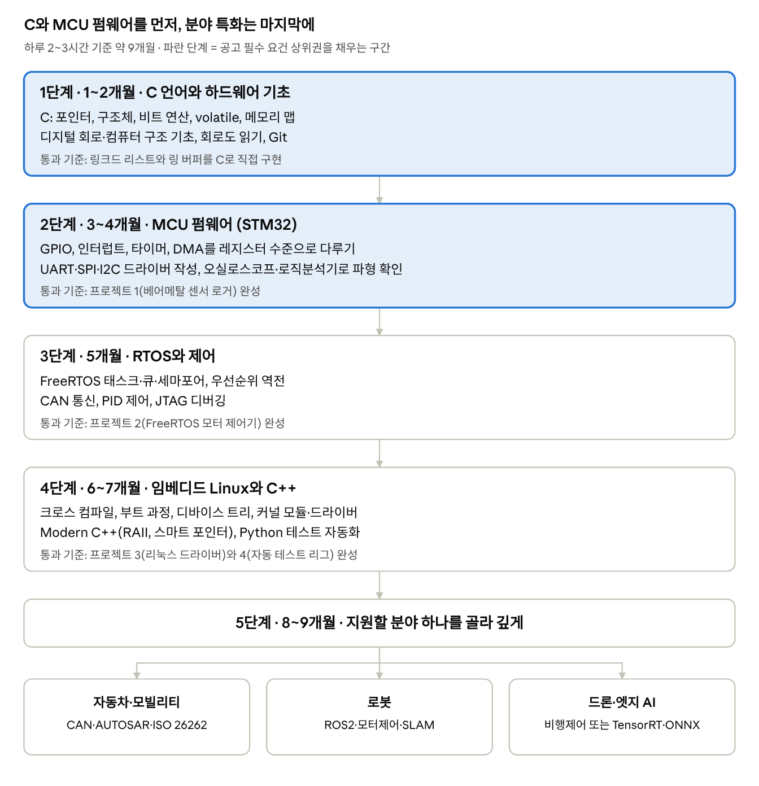
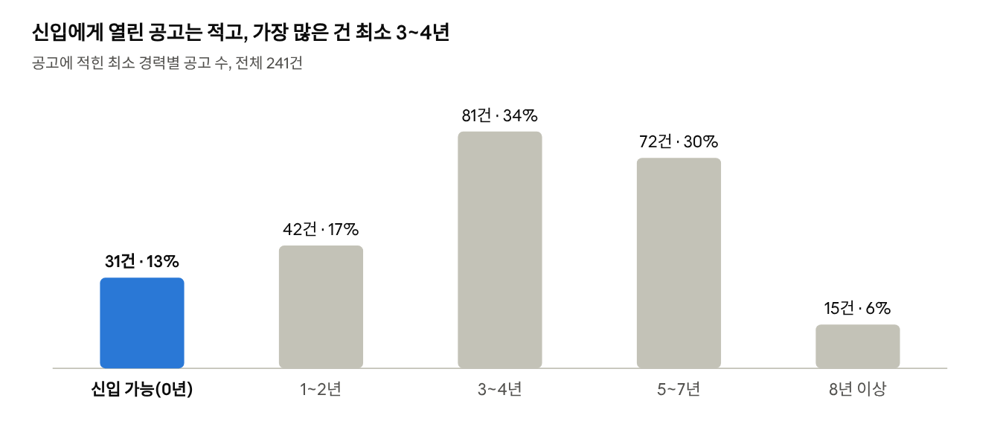

# 임베디드 개발자 취업 학습 로드맵

2026-10-12 · 원티드 임베디드 공고 241건 분석 기반

## 요약

**C/C++로 MCU 펌웨어를 직접 짜 보는 것이 1순위입니다.** 원티드 임베디드 공고 241건(149개 기업) 중 115건(48%)이 C 또는 C++를 자격요건에 적었습니다. 그다음이 Linux(56건), Python(54건), 회로도·PCB(44건), 펌웨어(42건), MCU(35건)입니다.

- **1순위, 대부분의 공고가 필수로 요구:** C/C++, MCU 펌웨어, UART·SPI·I2C 통신, 회로도 읽기와 오실로스코프 같은 계측장비
- **2순위, 필수로 자주 등장:** Linux, Python, Git
- **3순위, 우대가 필수보다 많아 차별화 포인트:** RTOS, 디바이스 드라이버, ROS2, 기능안전(ISO 26262)

최소 경력 0년으로 열린 공고는 31건(13%)뿐이라, 경력 대신 실력을 보여 줄 포트폴리오 프로젝트가 꼭 필요합니다.

## 시장이 원하는 것

*원티드 임베디드 공고 241건 · 2026-10-12 수집 · 본문 키워드 집계, 기술 요건 상위 17개*

진한 막대가 긴 요건부터 공부하고, 연한 막대가 더 긴 RTOS·드라이버·ROS2·기능안전은 기본기를 다진 뒤 차별화용으로 익히세요. 학력 조건은 전공(전자·전기·컴공 등) 명시가 92건, 학사 이상이 71건, 석사 이상이 25건입니다.

## 공부 순서

*공부 순서 · 5단계, 마지막 단계에서 3개 분야로 갈림*

1~2단계만 끝내도 필수 요건 상위 9개(C/C++, 펌웨어, MCU, 회로도, 계측장비, 통신, Git) 대부분을 채울 수 있습니다. 5단계 분야는 공고에서 로봇(필수 35건), 자동차(21건), 드론·항공(16건) 순으로 많았습니다.

## 포트폴리오 프로젝트

프로젝트 4개를 끝내면 필수 요건 상위 10개를 모두 직접 해 본 경험으로 설명할 수 있습니다. 각 프로젝트는 GitHub에 코드, 회로 연결도, 동작 영상, 오실로스코프 파형 캡처를 함께 올리세요.

| 프로젝트 | 만드는 것 | 채우는 공고 요건 | 예상 기간 |
| --- | --- | --- | --- |
| 1. 베어메탈 센서 로거 | STM32에서 I2C 온습도 센서·SPI 플래시를 레지스터 수준으로 제어하고 UART로 PC에 출력 | C, MCU, STM32, UART·SPI·I2C, 계측장비, 펌웨어 | 4주 |
| 2. FreeRTOS 모터 제어기 | 태스크를 나눠 엔코더 읽기, PID 제어, CAN 메시지 송수신 | RTOS, 제어 이론, CAN, 디버거(JTAG) | 5주 |
| 3. 라즈베리파이 리눅스 드라이버 | 직접 만든 센서 보드용 커널 드라이버 + C++ 사용자 앱 + Yocto 또는 Buildroot 이미지 | Linux, 커널·드라이버, Embedded Linux, C++ | 6주 |
| 4. 자동 테스트 리그 | Python으로 1~3번 장치를 시리얼로 제어해 회귀 테스트, GitHub Actions로 빌드 | Python, Git, CI/CD | 2주 |

회로도·PCB(44건) 요건까지 노린다면 1번 또는 3번 프로젝트의 센서 보드를 KiCad로 직접 그려 제작하면 됩니다.

## 신입 지원 전략

*원티드 임베디드 공고 241건 · 공고에 적힌 최소 경력 기준*

신입 가능 공고 31건에서는 기술보다 **전공(16건)과 학사 이상(9건)** 조건이 더 자주 나왔고, 기술은 C·C++(각 10건), Python(7건), 회로도·펌웨어(각 6건) 순이었습니다. 신입에게는 폭보다 기본기를 본다는 뜻입니다.

- **1~2년 공고(42건)도 같이 노리세요.** 포트폴리오 1~3번을 끝내면 요구 기술을 대부분 채울 수 있습니다.
- **신입·인턴 공고 예시:** [엣지크로스 임베디드 SW(신입)](https://www.wanted.co.kr/wd/383980), [아이시냅스 펌웨어(신입)](https://www.wanted.co.kr/wd/381203), [에이로봇 펌웨어 인턴](https://www.wanted.co.kr/wd/300787), [넥스트랩 신입 회로개발자](https://www.wanted.co.kr/wd/390840), [메쥬 의료기기 펌웨어](https://www.wanted.co.kr/wd/384208)
- **전공이 다르다면** 프로젝트에 회로도와 파형 캡처를 넣어 하드웨어를 다룰 수 있다는 증거를 보여 주는 것이 가장 효과적입니다.
- **남성 미필자라면** 전문연구요원·병역특례를 언급한 공고가 5건 있었으니 검색해 보세요.

## 방법과 한계

- **데이터:** [원티드 개발 › 임베디드 개발자 외 1개 직무 목록](https://www.wanted.co.kr/wdlist/518?country=all&job_sort=job.popularity_order&years=-1&selected=658&selected=672)의 공고 241건을 2026년 10월 12일에 모두 열어 자격요건과 우대사항 본문을 받았습니다.
- **집계:** 본문에서 68개 키워드를 찾아 센 값입니다. 필수 = 자격요건에 있음, 우대 = 우대사항에만 있음으로 나눠서 한 공고가 두 번 세지지 않게 했습니다.
- **한계:** 특이한 표현으로 적힌 요건은 빠졌을 수 있고, 3건은 자격요건 본문이 비어 있습니다. 로드맵의 기간과 프로젝트는 하루 2~3시간 공부를 가정한 제안이며, 공고 데이터가 아닙니다.
- 공고별 원문은 [채용 요건 대시보드](../dashboard/index.html)에서 검색해 볼 수 있습니다.
